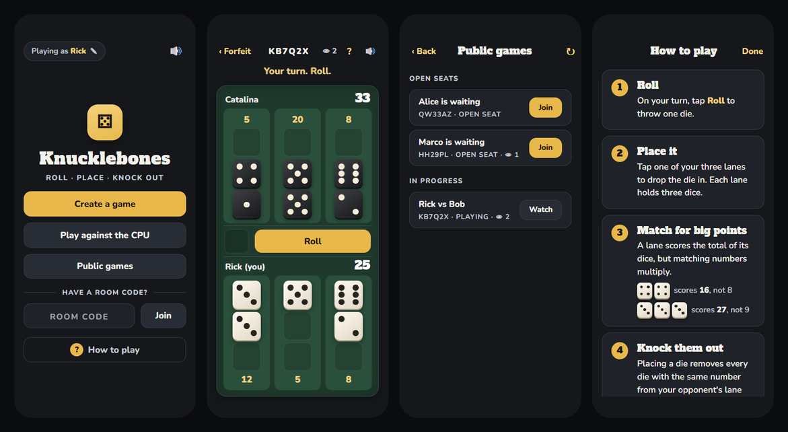

# Knucklebones for LB Phone

Knucklebones, the dice game from *Cult of the Lamb*, as an app for
LB Phone on FiveM. Two players anywhere on the server
play from their phones, other players can watch, and there is a CPU opponent
for playing alone. The server runs every game, so clients cannot fake rolls or
moves.



## Features

- **Public and private games.** Public games are listed for anyone to join or
  watch. Private games are reachable only with their six-character room code.
- **CPU opponent** with a random name from a list you control.
- **Spectating** of any public game, with a live spectator count.
- **Character names.** Players appear under their character's first name, or
  under a nickname they choose in the app. Every nickname change is logged.
- **Built-in guide.** A full-screen how-to-play sheet, reachable from the lobby
  and from inside a game.
- **Sound and motion.** Recorded dice sounds, a tumbling roll, and distinct
  effects for knocking out your opponent's dice or losing your own. Players can
  mute it.
- **Phone-friendly layout.** It scales with the player's phone size, follows
  the phone's light or dark theme, and keeps buttons away from the home bar.
- **Auto-install.** The app adds itself to every phone. Nobody has to visit
  the app store.

## Requirements

| Resource | Needed for |
|---|---|
| `lb-phone` | The phone itself. Required. |
| `ox_lib` | Loaded by the manifest, and used for `lib.logger`. Required. |
| `qbx_core` | Character first names. Optional: without it, players show their FiveM name. |

## Installation

1. Clone or download this repository into your resources folder. The folder
   name is up to you; the example below uses `noted_knucklebones_phone`.

   ```sh
   git clone https://github.com/NotedDevelopment/noted_knucklebones noted_knucklebones_phone
   ```

2. Start it after its dependencies, using your folder name:

   ```cfg
   ensure lb-phone
   ensure ox_lib
   ensure qbx_core
   ensure noted_knucklebones_phone
   ```

3. Restart the server, or start the resource. The app registers itself with
   LB Phone and re-registers if LB Phone restarts.

The `logs` folder must stay in place. The server writes nickname changes there.

## Configuration

Everything lives in `config.lua`. Changes need a resource restart, not a rebuild.

| Setting | Default | What it does |
|---|---|---|
| `AppInfo` | | The app's identifier, name, description, developer and size as shown on the phone. `defaultApp = true` installs it on every phone. |
| `CpuNames` | Boop, Dave, DJ, Catalina, Carmen, Thor | The CPU opponent takes one at random each game. Add as many as you like. |
| `Nickname.MinLength` / `MaxLength` | 2 / 16 | Allowed nickname length. The app reads these from the server. |
| `Nickname.Pattern` | letters, digits, spaces, `'` and `-` | A Lua pattern every nickname must match. |
| `Nickname.Cooldown` | 5 | Seconds a player must wait between nickname changes. |
| `TurnTimeout` | 180 | Seconds per turn in games between two people. A player who runs out of time forfeits. CPU games have no clock. |
| `AiThinkTime` | 900 | Milliseconds the CPU waits before each roll and placement. |
| `RoomCodeLength` | 6 | Length of room codes. |

To change the icon, replace `ui/icon.svg`.

## How to play

1. On your turn, tap **Roll** to throw one die.
2. Tap one of your three lanes to place it. Each lane holds three dice.
3. A lane scores the total of its dice, but matching numbers multiply. Two 4s
   score 16 instead of 8, and three 3s score 27 instead of 9.
4. Placing a die removes every die with the same number from your opponent's
   lane directly across.
5. The game ends the moment either player fills all nine slots. The higher
   total wins.

Forfeiting, leaving or disconnecting mid-game hands the win to the opponent.
After a game, both players press **Play again** for a rematch. The CPU always
accepts.

## Nickname logging

Each change records the time, the character's name, the player's licence and
FiveM name, and the old and new nickname. It goes to three places:

- **The server console.** txAdmin keeps it in its logs.
- **`logs/nicknames.log`** inside the resource. Lines are appended.
- **`lib.logger`** with the event name `nickname`. ox_lib only forwards this
  when a log service is configured with `ox:logger` and its key in your
  `ox.cfg`.

Nicknames are stored per licence in the resource's key-value store, so they
survive restarts and follow the player across characters.

## How it works

- `server/main.lua` owns rooms, membership, privacy, spectators, nicknames, and
  the CPU's turns. Every roll and placement is checked against the current
  match and revision before it is applied, and stale or out-of-turn actions are
  rejected.
- `shared/game.lua` packs the whole board into one number. `server/match.lua`
  applies actions to it and plays the CPU. Both are byte-identical copies of
  the files in `noted_knucklebones`, the physical table version of this game.
- `client/main.lua` registers the app and relays messages between the phone
  page and the server.
- `ui/` is a plain HTML, CSS and JavaScript page with no build step. It is
  loaded twice in game: once inside the phone, and once as the resource's own
  page, which stays invisible.

## Development

The tests need Python 3 and [`lupa`](https://pypi.org/project/lupa/):

```sh
pip install lupa
python tests/run.py
```

They compile every Lua file, run a full room flow through the real server
script with the game natives stubbed out, and cover nicknames and logging. If
`noted_knucklebones` sits next to this folder, they also check that the shared
rule files have not drifted apart.

## Credits

- **Dice and chip sounds:** [Casino Audio](https://kenney.nl/assets/casino-audio)
  by Kenney, CC0 1.0. See `ui/sounds/LICENSE.txt`.
- **Nunito:** by the Nunito Project Authors, SIL Open Font License 1.1. See
  `ui/fonts/OFL-Nunito.txt`.
- **Alfa Slab One:** by JM Solé, SIL Open Font License 1.1. See
  `ui/fonts/OFL-AlfaSlabOne.txt`.
- **Knucklebones** was designed for *Cult of the Lamb* by Massive Monster.
  This project is a fan implementation and is not affiliated with Massive
  Monster or Devolver Digital.

## License

Copyright (C) 2026 NotedDevelopment

This program is free software: you can redistribute it and/or modify it under
the terms of the GNU General Public License as published by the Free Software
Foundation, either version 3 of the License, or (at your option) any later
version.

This program is distributed in the hope that it will be useful, but WITHOUT
ANY WARRANTY; without even the implied warranty of MERCHANTABILITY or FITNESS
FOR A PARTICULAR PURPOSE. See the GNU General Public License for more details.

You should have received a copy of the GNU General Public License along with
this program. If not, see <https://www.gnu.org/licenses/>. The full text is in
[`LICENSE`](LICENSE).

The fonts and sounds bundled in `ui/fonts` and `ui/sounds` are not covered by
the GPL. They keep their own licenses, listed under Credits.
